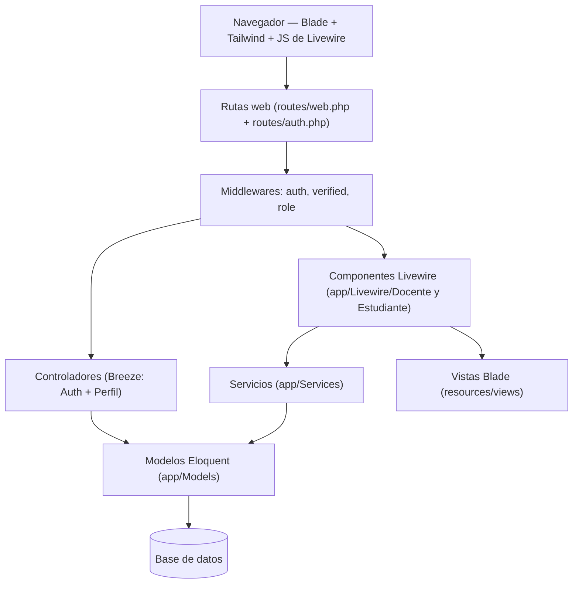

# Arquitectura

> Documentación generada a partir de la estructura de `app/`, `routes/`, `config/` y `resources/`.
> Última actualización: 2026-10-17.

## Contenido

1. [Patrones de diseño](#1-patrones-de-diseño)
2. [Controladores, middlewares y rutas](#2-controladores-middlewares-y-rutas)
3. [Frontend y vistas integradas](#3-frontend-y-vistas-integradas)
4. [Estructura de carpetas](#4-estructura-de-carpetas)
5. [Registro de decisiones de diseño](#5-registro-de-decisiones-de-diseño)
6. [Observaciones](#6-observaciones)

---

## 1. Patrones de diseño

El proyecto sigue el **MVC de Laravel** con una capa de **servicios** para la lógica de negocio y una capa de presentación basada en **componentes Livewire** en lugar de controladores tradicionales.



Capas y cómo se relacionan:

- **Presentación**: componentes Livewire (`app/Livewire/Docente/*`, `app/Livewire/Estudiante/*`) que exponen propiedades públicas y acciones `wire:*`. Las vistas Blade correspondientes viven en `resources/views/components/docente/` y `.../estudiante/`. Los controladores HTTP **no** participan en el flujo de negocio: solo cubren autenticación (Breeze) y perfil de usuario.
- **Lógica de negocio (Service Layer)**: `app/Services/` con tres servicios concretos:
  - `AsistenciasService`: estado de asistencia por fecha, guardado masivo (upsert) e historial semestral.
  - `CalificacionesService`: matriz de notas, creación/eliminación de evaluaciones, guardado transaccional de notas y cálculo de notas finales ponderadas.
  - `GrupoEstudiantesService`: búsqueda de estudiantes registrados, alta y baja en un grupo (pivote `grupo_estudiante`).
  - Los servicios se resuelven en los componentes con `app(Servicio::class)` (contenedor de dependencias). **No hay interfaces ni repositorios**: no existe patrón Repository ni inyección constructora; los servicios consultan los modelos Eloquent directamente y usan `DB::transaction` para escrituras multi-paso.
- **Modelos**: Eloquent (`app/Models/`), con relaciones y helpers propios (ver `docs/base_datos.md`).
- **Autenticación y autorización**: Breeze (estarter kit) + middleware personalizado `role` basado en la tabla `roles` (ver sección 2).
- **Validación**: en los flujos de negocio se hace en los propios componentes Livewire con `$this->validate()`; los `FormRequest` solo se usan en Breeze (`app/Http/Requests/Auth/`) y en el perfil (`ProfileUpdateRequest`).
- **Acciones sin re-renderizado**: los métodos de persistencia usan el atributo `#[Renderless]` de Livewire.

---

## 2. Controladores, middlewares y rutas

### 2.1 Controladores

| Ubicación | Clase | Origen / propósito |
|---|---|---|
| `app/Http/Controllers/Controller.php` | `Controller` | Base abstracta vacía (Laravel 12) |
| `app/Http/Controllers/ProfileController.php` | `ProfileController` | Breeze: ver/editar/eliminar perfil de usuario |
| `app/Http/Controllers/Auth/*` | 9 controladores | Breeze: registro, login/logout, verificación de email, recuperación y confirmación de contraseña |
| `app/Http/Controllers/ActividadArchivoController.php` | `ActividadArchivoController` | Controlador *invokable*: visualización en línea del archivo adjunto de una actividad (valida que el grupo pertenezca al docente autenticado) |

> No hay controladores de negocio: todas las páginas de dominio (grupos, notas, asistencia, actividades, dashboards) son **componentes Livewire** apuntados directamente por las rutas. La única excepción es `ActividadArchivoController`, que solo sirve archivos adjuntos en línea (no define vistas ni flujos de página).

### 2.2 Middlewares

- **Estándares de Laravel** (grupo `web`): `auth`, `verified`, `guest`, `throttle`, `signed`, etc.
- **Personalizado**: `App\Http\Middleware\RoleMiddleware`, registrado con el alias **`role`** en `bootstrap/app.php` (`$middleware->alias`).
  - Uso: `role:docente`, `role:estudiante` o multi-rol `role:administrativo,superadministrador`.
  - Comportamiento: sin usuario autenticado → `401`; si el rol del usuario (columna `roles.nombre`, comparado en minúsculas) no está en la lista → `403` con el mensaje "No tienes permisos para acceder a esta sección."

### 2.3 Rutas

No existe `routes/api.php`: **toda la aplicación es web** (solo hay un endpoint de salud `GET /up` registrado en `bootstrap/app.php`).

`routes/web.php` (archivo principal, incluye `auth.php` al final):

| Método | URI | Nombre | Middlewares | Destino |
|---|---|---|---|---|
| `GET` | `/` | — | — | Vista `inicio` (pública) |
| `GET` | `/dashboard` | `dashboard` | `auth`, `verified` | **Redirige por rol**: `estudiante` → `estudiante.dashboard`, `docente` → `docente.dashboard`; si el rol no coincide, muestra la vista `dashboard` (genérica Breeze) |
| `GET` | `profile` | `profile.edit` | `auth` | `ProfileController@edit` |
| `PATCH` | `profile` | `profile.update` | `auth` | `ProfileController@update` |
| `DELETE` | `profile` | `profile.destroy` | `auth` | `ProfileController@destroy` |
| `GET` | `docente/dashboard` | `docente.dashboard` | `auth`, `role:docente` | `Livewire\Docente\Dashboard` |
| `GET` | `docente/grupos` | `docente.grupos` | `auth`, `role:docente` | `Livewire\Docente\GrupoEstudiantes` |
| `GET` | `docente/grupo/{grupoId}/notas` | `docente.grupo.notas` | `auth`, `role:docente` | `Livewire\Docente\GrupoNotas` |
| `GET` | `docente/grupo/{grupoId}/asistencia` | `docente.grupo.asistencia` | `auth`, `role:docente` | `Livewire\Docente\GrupoAsistencia` |
| `GET` | `docente/grupo/{grupoId}/asistencia/historial` | `docente.grupo.asistencia.historial` | `auth`, `role:docente` | `Livewire\Docente\HistorialAsistencia` |
| `GET` | `docente/actividades` | `docente.actividades` | `auth`, `role:docente` | `Livewire\Docente\GrupoActividades` |
| `GET` | `docente/actividad/{actividad}/archivo` | `docente.actividad.archivo` | `auth`, `role:docente` | `ActividadArchivoController` (archivo adjunto en línea) |
| `GET` | `docente/grupo/{grupoId}/actividades` | `docente.grupo.actividades` | `auth`, `role:docente` | `Livewire\Docente\GrupoActividades` |
| `GET` | `estudiante/dashboard` | `estudiante.dashboard` | `auth`, `role:estudiante` | `Livewire\Estudiante\Dashboard` |
| `GET` | `estudiante/notas` | `estudiante.notas` | `auth`, `role:estudiante` | `Livewire\Estudiante\Notas` |
| `GET` | `estudiante/talleres` | `estudiante.talleres` | `auth`, `role:estudiante` | `Livewire\Estudiante\Talleres` |

> **Redirección de `/dashboard`**: la ruta genérica de Breeze resuelve el rol con `strtolower(auth()->user()->role?->nombre ?? '')` y redirige a `estudiante.dashboard` o `docente.dashboard` cuando coincide; cualquier otro rol (o ninguno) cae en la vista `dashboard` original. Esto evita que un usuario de panel vea la página genérica tras iniciar sesión.

`routes/auth.php` (Breeze, requerido desde `web.php`):

- **Grupo `guest`**: `GET/POST register`, `GET/POST login`, `GET/POST forgot-password`, `GET reset-password/{token}` + `POST password.store`.
- **Grupo `auth`**: `GET verify-email`, `GET verify-email/{id}/{hash}` (`signed` + `throttle:6,1`), `POST email/verification-notification` (`throttle:6,1`), `GET/POST confirm-password`, `PUT password`, `POST logout`.

`routes/console.php`: comando artisan `inspire` (placeholder).

### 2.4 Configuración relevante (`config/`)

Archivos estándar de Laravel 12: `app`, `auth` (guard `web`, proveedor de usuarios `users`), `cache`, `database`, `filesystems` (disco `public` usado para los archivos de las actividades), `logging`, `mail`, `queue`, `services`, `session` (driver de sesión: tabla `sessions`).

---

## 3. Frontend y vistas integradas

### 3.1 Stack

| Tecnología | Uso |
|---|---|
| **Blade** | Plantillas de todas las vistas (`resources/views/`) |
| **Livewire 4.3.5** (clásico, basado en clases) | Componentes interactivos de las páginas de negocio |
| **Laravel Volt** | Instalado (`livewire/volt`) y montado en `VoltServiceProvider` (`views/livewire`, `views/pages`), pero **no se usan páginas Volt**; el directorio `views/livewire` está vacío (`.gitkeep`) |
| **Tailwind CSS** | Estilos, compilado con Vite (`resources/css/app.css`) |
| **Vite** | Bundling de JS/CSS (`@vite` en los layouts) |
| **Axios** | Configurado en `resources/js/bootstrap.js` |
| **Alpine.js** | Instalado pero **descomentado/desactivado** en `resources/js/app.js` |

### 3.2 Layouts

| Layout | Características |
|---|---|
| `layouts/app` | Breeze: navegación superior (`layouts/navigation`), slot `$header` + `@yield('contenido')`, usa `x-app-layout` / `AppLayout` (componente Blade de `app/View/Components/`) |
| `layouts/guest` | Breeze: páginas de autenticación (`GuestLayout`) |
| `layouts/docente` | Propio ("Aula Digital – Panel Docente"): sidebar oscuro con navegación (Dashboard, Grupos, Actividades, etc.), barra superior con usuario y slot de contenido. **No incluye** `@livewireStyles`/`@livewireScripts` (confía en la autoinyección de Livewire 4.3.5 para componentes-página) |
| `layouts/estudiante` | Propio ("Aula Digital – Panel del estudiante"): reestructurado con **sidebar** oscuro fijo (`Inicio`, `Mis Notas`, `Talleres` y enlaces marcadores `Guías de Estudio`, `Calendario`, `Mensajes`, más `Mi Perfil` y `Cerrar sesión`), barra superior *sticky* con usuario y campana de notificaciones (contador 0), y navegación inferior horizontal para móvil (`md:hidden`). Marca activa con `request()->routeIs(...)`. Renderiza `{{ $slot ?? '' }}` **y** `@yield('contenido')`, y sí incluye `@livewireStyles` / `@livewireScripts` |

Los componentes de negocio renderizan su vista y aplican el layout con `view('components.docente.⚡grupo-notas')->layout('layouts.docente')`.

### 3.3 Vistas y componentes

- `resources/views/components/docente/`: 6 vistas del panel docente (`dashboard` + páginas interactivas).
- `resources/views/components/estudiante/`: 3 vistas interactivas (`⚡dashboard`, `⚡notas`, `⚡talleres`).
- **Convención de nombres**: las vistas de páginas Livewire llevan el prefijo `⚡` (ej. `⚡grupo-notas.blade.php`) para distinguirlas de las vistas estáticas (ej. `dashboard.blade.php`).
- Componentes UI reutilizables en `resources/views/components/`: `modal`, `primary-button`, `secondary-button`, `danger-button`, `text-input`, `input-label`, `input-error`, `dropdown*`, `nav-link`, `responsive-nav-link`, `application-logo`, `auth-session-status` y `ui/icon-button` (con `wire:click`).
- Vistas sueltas: `inicio.blade.php` (página pública), `dashboard.blade.php` (genérico Breeze), `welcome.blade.php`, `auth/*` (6 vistas Breeze), `profile/*`.

### 3.4 Interacción del panel docente (ejemplos de patrones Livewire)

- `wire:model` / `wire:model.live.debounce.300ms` (búsqueda de estudiantes), `wire:submit.prevent`, `wire:confirm`, `wire:key` (tabla de notas), estados de carga con `wire:loading` + `wire:target`.
- Validación de formularios en el componente con `$this->validate()`.
- Mensajes al usuario con `session()->flash('mensaje', ...)`.
- Carga de archivos (`GrupoActividades`): trait `WithFileUploads`, guardado en disco `public` bajo `actividades/` (tipos permitidos: pdf, doc, docx, xls, xlsx, ppt, pptx, zip; máximo 10 MB); el archivo se elimina del disco al borrar o reemplazar la actividad.
- Visualización en línea de archivos (`ActividadArchivoController`): la ruta `docente.actividad.archivo` (`/docente/actividad/{actividad}/archivo`) responde el archivo con `Content-Disposition: inline` y `X-Content-Type-Options: nosniff`; antes valida que la actividad pertenezca a un grupo del docente autenticado (403) y que el archivo exista en el disco `public` (404). El enlace "Ver archivo" de `⚡grupo-actividades` apunta a esta ruta.
- **Taller → evaluación automática** (`GrupoActividades::crearActividad()` / `actualizarActividad()`): al crear (o al pasar a) una actividad de tipo `taller` se crea en la misma transacción una `Evaluacion` vinculada por `actividad_id`, con `nombre` = título del taller, `porcentaje = 0` y `tipo = 'taller'`. Al editar se sincroniza `nombre` y `grupo_id`; si la actividad deja de ser taller la evaluación **no** se elimina (se conservan las notas).
- **Gestión de entregas** (`verRespuestas()`, `cerrarRespuestas()`, `abrirDetalleRespuesta()`): el botón "Respuestas" de cada taller abre la lista de `actividad_respuestas` del taller con el estudiante, asunto, resumen, archivo adjunto y el formulario de nota. Al abrir el detalle se marca `leida_at` si aún era nula; en el listado se muestra un contador de **respuestas sin leer** (`respuestas_sin_leer_count`).
- **Calificación de talleres** (`guardarNota()`): guarda (0–5) la nota del estudiante en la evaluación vinculada al taller mediante `Calificacion::updateOrCreate`, dentro de una transacción. Solo actúa si la actividad es un `taller` y tiene evaluación vinculada.
- **Mensajes del docente** (solo talleres): mensaje **general** del taller (`abrirModalMensaje()` / `guardarMensajeDocente()`, columna `actividades.mensaje_docente`) y mensaje **individual** por entrega (`abrirMensajeIndividual()` / `guardarMensajeIndividual()`, columna `actividad_respuestas.mensaje_docente`).

> Todas estas acciones validan que la actividad/entrega pertenezca a un grupo del docente autenticado (`whereHas('grupo.docente', ...)` + `firstOrFail`) y usan `session()->flash('mensaje', ...)` para el aviso de éxito.

### 3.5 Páginas del panel estudiante

`Dashboard` y `Notas` son componentes de solo lectura; `Talleres` permite además registrar entregas. Todos comparten la misma salvaguarda inicial: si `Auth::user()->estudiante` es `null` responden `abort(403, 'El usuario no tiene un registro de estudiante.')`, y todos usan `->layout('layouts.estudiante')`.

| Componente | Vista | Qué muestra / hace |
|---|---|---|
| `Estudiante\Dashboard` | `⚡dashboard` | Saludo personalizado (primer nombre), 4 tarjetas resumen (Promedio General **real**, promedio de las notas finales de sus materias con nota; Talleres Pendientes; Guías Disponibles `—`; y Próxima Entrega), "Mis Notas" con la nota final por materia, y "Talleres Pendientes". Se actualiza con `wire:poll.30s` |
| `Estudiante\Notas` | `⚡notas` | Tabla "Mis Notas": por cada grupo inscrito, sus evaluaciones (fecha/id) con la calificación propia (chip con color según la nota) y el **promedio ponderado** (`nota × porcentaje / 100`, redondeado a 1 decimal; `null` si no hay ninguna nota) |
| `Estudiante\Talleres` | `⚡talleres` | Tabla "Mis talleres": todas las actividades **tipo `taller`** de sus grupos con materia, fecha/hora límite, estado (`Revisado`/`Entregado`/`Vencido`/`Pendiente`) y calificación; permite **entregar/editar la entrega**, ver el taller, ver la propia respuesta y filtrar (`pendientes` / `entregados` / `todos`, ya conectados) |

Patrones propios de estas páginas:

- Consultas con `whereHas('estudiantes', ...)` sobre `Grupo` (o `$estudiante->grupos()`) para limitar los datos al estudiante autenticado, ordenadas por `anio` desc y `semestre`.
- Carga *eager* de `materia`, `evaluaciones` y `evaluaciones.calificaciones` filtradas por `estudiante_id` (en `Notas` y `Dashboard`) y de `docente.user`, `actividades` y `respuestas` (en `Dashboard` y `Talleres`).
- El promedio por materia (y el promedio general del dashboard) se calcula con la suma ponderada; en el dashboard el "Promedio General" es el promedio de las notas finales de las materias que **sí** tienen nota.
- **Entregas de talleres** (`Talleres::abrirRespuesta()`, `guardarRespuesta()`, `verRespuesta()`, `verTaller()`): el estudiante responde con `asunto`, texto y/o archivo (PDF, Word, Excel, PowerPoint o ZIP; máx. 10 MB, guardado en `entregas/` del disco `public`). Se usa `updateOrCreate` sobre (`actividad_id`, `estudiante_id`) y se elimina el archivo anterior al reemplazarlo. Reglas: no se puede entregar si el plazo (`fecha_limite` + `hora_limite`) ya venció, ni editar una entrega ya **calificada**; puede entregarse texto, archivo o ambos.
- **Visualización de mensajes** (estudiante): el detalle del taller y el modal "Mi respuesta" muestran el **mensaje general** del docente (bloque azul) y el **mensaje individual** de la entrega (bloque esmeralda junto a la calificación); la nota de la tabla muestra el mensaje general en el `title`.
- El filtro `entregados` **ya está conectado** al sistema de entregas (`actividad_respuestas`); `pendientes` es el valor por defecto.
- La tarjeta "Guías Disponibles" del dashboard sigue mostrando `—` ("Próximamente"); el sidebar mantiene los enlaces marcadores `Guías de Estudio`, `Calendario` y `Mensajes`.

---

## 4. Estructura de carpetas

```
app/
├── Http/
│   ├── Controllers/
│   │   ├── Controller.php            # Base vacía (Laravel 12)
│   │   ├── ProfileController.php     # Breeze: perfil
│   │   └── Auth/                     # 9 controladores Breeze (login, registro, contraseñas, verificación)
│   ├── Middleware/
│   │   └── RoleMiddleware.php        # Alias "role": role:docente, role:estudiante, ...
│   └── Requests/
│       ├── ProfileUpdateRequest.php  # Breeze
│       └── Auth/                     # FormRequests de Breeze (Registro, Login, etc.)
├── Livewire/
│   ├── Docente/                      # Dashboard, GrupoEstudiantes, GrupoNotas,
│   │                                 # GrupoAsistencia, HistorialAsistencia, GrupoActividades
│   └── Estudiante/                   # Dashboard, Notas, Talleres
├── Models/                           # 12 modelos Eloquent (ver docs/base_datos.md)
├── Providers/
│   ├── AppServiceProvider.php        # Vacío (placeholder)
│   └── VoltServiceProvider.php       # Volt::mount(...) — Volt instalado pero sin páginas
├── Services/
│   ├── AsistenciasService.php
│   ├── CalificacionesService.php
│   └── GrupoEstudiantesService.php
└── View/Components/
    ├── AppLayout.php                 # Componente Blade => layouts.app
    └── GuestLayout.php               # Componente Blade => layouts.guest

routes/
├── web.php                           # Rutas públicas, perfil, docente y estudiante; requiere auth.php
├── auth.php                          # Rutas Breeze (guest + auth)
└── console.php                       # Comando "inspire"

config/                               # 10 archivos estándar: app, auth, cache, database,
                                      # filesystems, logging, mail, queue, services, session

resources/
├── css/app.css                       # Tailwind
├── js/
│   ├── app.js                        # Importa bootstrap; Alpine comentado
│   └── bootstrap.js                  # Setup de axios
└── views/
    ├── layouts/
    │   ├── app.blade.php             # Breeze (nav superior)
    │   ├── guest.blade.php           # Breeze (páginas de auth)
    │   ├── navigation.blade.php      # Menú superior de layouts.app
    │   ├── docente.blade.php         # Panel docente (sidebar)
    │   └── estudiante.blade.php      # Panel estudiante (sidebar + barra sticky + nav móvil)
    ├── auth/                         # 6 vistas Breeze
    ├── profile/                      # edit + partials
    ├── components/
    │   ├── ui/icon-button.blade.php  # Botón de ícono con wire:click
    │   ├── docente/                  # dashboard + 5 páginas ⚡ (Livewire)
    │   ├── estudiante/               # ⚡dashboard, ⚡notas, ⚡talleres (Livewire)
    │   └── *.blade.php               # Componentes UI reutilizables (botones, modal, inputs...)
    ├── dashboard.blade.php           # Dashboard genérico Breeze
    ├── inicio.blade.php              # Página pública
    ├── welcome.blade.php
    └── livewire/                     # Vacío (punto de montaje de Volt, sin uso)
```

---

## 5. Registro de decisiones de diseño

Decisiones registradas previamente en este documento:

- **Decisión 001** — Los estudiantes pertenecen a un grupo.
- **Decisión 002** — Cada grupo se crea con un conjunto de evaluaciones oficiales P1, P2, P3, P4 y A con porcentajes predefinidos.
- **Decisión 003** — El docente puede crear evaluaciones adicionales personalizadas, siempre que no utilice los nombres reservados de las evaluaciones oficiales.
- **Decisión 004** — Solo Administración y Superadministrador pueden cerrar un grupo.
- **Decisión 005** — El `tipo` de las actividades es texto libre: se normaliza a minúsculas al guardar y se compara siempre de forma insensible a mayúsculas (el dashboard docente lo convierte a minúsculas antes de buscar `taller`).
- **Decisión 006** — El layout `layouts/estudiante` soporta los dos estilos de renderizado: `{{ $slot ?? '' }}` para los componentes Livewire-página (que inyectan el HTML en el slot) y `@yield('contenido')` para vistas que se rendericen con `@section('contenido', ...)`. Así el layout no se rompe si alguna página futura deja de ser un componente Livewire.
- **Decisión 007** — La ruta `/dashboard` de Breeze redirige al panel del rol correspondiente (`estudiante`/`docente`) resolviendo el nombre del rol en minúsculas; los usuarios sin rol compatible siguen cayendo en la vista genérica, sin perder el comportamiento original.
- **Decisión 008** — Un taller genera automáticamente su propia `Evaluacion` (vinculada por `evaluaciones.actividad_id`, UNIQUE) con `porcentaje = 0` y `tipo = 'taller'`, de modo que la nota del taller se guarda en `calificaciones` sin depender de crear la evaluación a mano. Si la actividad deja de ser taller, la evaluación se conserva para no perder las notas.
- **Decisión 009** — Las entregas de los estudiantes se almacenan en `actividad_respuestas` (una por `actividad_id` + `estudiante_id`, UNIQUE) y **no** pueden modificarse una vez el docente asignó una nota ni cuando el plazo ya venció (se abren en modo solo lectura).
- **Decisión 010** — Los mensajes del docente para los talleres se guardan en dos niveles: uno **general** por taller (`actividades.mensaje_docente`) y uno **individual** por entrega (`actividad_respuestas.mensaje_docente`); ambas acciones están restringidas a actividades de tipo `taller`.

Nota: la Decisión 002 se implementa en `GrupoEstudiantes::crearNuevoGrupo()`, que inserta automáticamente las evaluaciones `P1`–`P4` y `A` (20%, 20%, 20%, 30%, 10%) al crear un grupo; `GrupoNotas::agregarEvaluacion()` impide renombrar evaluaciones con esos nombres y crea evaluaciones `personalizada` para el resto.

Nota: la Decisión 005 surgió porque la base de datos es PostgreSQL, que distingue mayúsculas al comparar texto: un taller creado como "Taller" no coincidía con `where('tipo', 'taller')` y el dashboard docente lo contaba como 0. Se implementa en `GrupoActividades` (guarda el `tipo` con `mb_strtolower`) y en `Docente\Dashboard` (filtra con `mb_strtolower($actividad->tipo) === 'taller'`), la misma convención que ya usaba el dashboard del estudiante.

---

## 6. Observaciones

- **No hay API REST**: no existe `routes/api.php` ni grupo de middlewares `api`; la interacción cliente-servidor ocurre vía web (formularios, Livewire).
- **SQL no portable en servicios**: `GrupoEstudiantesService` usa `ilike` (PostgreSQL) y `LOWER(nombre) = ?`; además filtra por `role_id = 4` hardcodeado (número mágico del rol "estudiante") en lugar de comparar el nombre del rol.
- **Volt instalado pero inactivo**: `VoltServiceProvider` y `views/livewire`/`views/pages` están listos para páginas Volt, pero el proyecto usa componentes Livewire clásicos; se puede documentar/eliminar para evitar confusión.
- **Alpine.js desactivado**: está en `package.json` pero `resources/js/app.js` lo tiene comentado; el intermezzo UI lo cubre Livewire (e.g., el modal se controla con propiedades booleanas del componente).
- **Panel docente sin `@livewireScripts` explícito**: `layouts/docente` no declara `@livewireStyles`/`@livewireScripts`; funciona porque Livewire 4.3.5 autoinyecta sus recursos cuando renderiza un componente-página por ruta. Si en el futuro se añaden componentes anidados (`<livewire: ...>`), conviene declararlos en el layout.
- **Placeholders sin conectar en el panel estudiante**: en el dashboard solo queda "Guías Disponibles" como `—` ("Próximamente") y los enlaces marcadores del sidebar (`Guías de Estudio`, `Calendario`, `Mensajes`). El "Promedio General", la tarjeta "Mis Notas" y el filtro "Entregados" de `/estudiante/talleres` **ya** usan datos reales.
- **Contador "Talleres Pendientes" del dashboard**: `Estudiante\Dashboard` calcula `talleresPendientes = $actividades->count()`, es decir, cuenta **todas** las actividades de sus grupos (de cualquier `tipo` y sin descontar las entregadas), no solo los talleres pendientes; conviene filtrar por `tipo === 'taller'` y por ausencia de entrega.
- **`evaluaciones.tipo` y el valor `taller`**: la migración inicial define `tipo` como `ENUM('parcial','asistencia_final','personalizada')`, pero la aplicación escribe `'taller'`. En PostgreSQL funciona porque la migración `remover_check_constraint_evaluaciones_tipo` elimina el `CHECK`; en MySQL (u otra base sin ese paso) el `ENUM` rechazaría `'taller'`. Conviene alinear el esquema (columna de texto) o ampliar el enum.
- **`calificaciones.comentario` vs. `actividad_respuestas.mensaje_docente`**: el docente escribe hoy la retroalimentación individual en `mensaje_docente` (desde el botón de mensaje por entrega); `Talleres::verRespuesta()` sigue cargando `comentario`, pero la vista del estudiante muestra el bloque de calificación con `mensaje_docente`. Queda un campo (`comentario`) sin uso en la interfaz; conviene unificar cuál de los dos es la retroalimentación oficial.
- **Notas de los archivos de la vista `⚡notas`**: la vista vive en `resources/views/components/estudiante/⚡notas.blade.php` (el prefijo `⚡` es U+26A1), por lo que en shells/terminales puede mostrarse codificado como `\342\232\241` al listar los cambios de Git.
